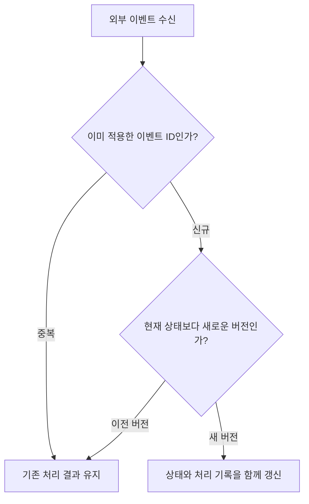

### 1. 개요 및 배경 (Context)

- **질문 요지** 웹훅 중복과 순서 역전에 대한 답변에서 멱등성 키, 프로젝트별 FIFO, 409 충돌, Outbox가 각각 무슨 역할을 하는가? 실제 저장 경험과 이어서 설명해 달라고 요청함.
- 면접 질문에서 외부 웹훅 수신의 중복 및 순서 처리와 로컬 저장의 Outbox를 한 설명에 섞어 쓴 이유를 되짚음.
- 같은 완료 통지가 다시 오거나, 새 상태를 적용한 뒤 이전 통지가 도착할 수 있음. **같은 이벤트인지**와 **현재 상태를 바꿀 만큼 새로운 이벤트인지**를 각각 확인해야 함.

### 2. 핵심 내용 / 문제 해결 과정 (Core / Troubleshooting)

- **답변에서 고른 방법** 같은 이벤트의 재전송, 다른 버전의 역순 도착, 오래된 버전으로 보낸 쓰기 요청을 다른 사례로 설명함. FIFO는 수신한 순서를 유지하므로 발생 순서가 뒤집혀 들어오면 버전 비교가 여전히 필요함. Outbox는 송신 보장으로 따로 설명하는 쪽이 당시 확인한 저장 경험과 외부 수신 설계의 경계를 보여 줌.
- **이벤트 ID**를 적용한 기록과 함께 남기면 재전송을 식별할 수 있음. 이벤트 두 개의 ID가 다르면 둘 다 신규로 보이므로, 최신 상태를 고르려면 발신 원본의 버전이나 상태를 기준으로 판단해야 함.
- 도착 순서대로 처리하면 수신 로직은 단순하지만 네트워크가 순서를 바꾸는 경우 오래된 값이 이길 수 있음. 엔티티별 버전 검사는 순서가 뒤집혀도 오래된 스냅샷을 제외할 수 있지만, 발신처가 비교 가능한 버전을 제공해야 함. 각 이벤트가 델타라면 중간 버전이 빠졌을 때 원본 조회나 재처리도 고려해야 함.
- **트랜잭션 아웃박스**는 발행 측에서 상태와 보낼 이벤트를 함께 기록해 발행 누락을 줄이는 방법임. 수신 측에서 적용한 ID와 버전을 확인하는 결정은 별도로 필요함.

- 도식은 버전이 있는 상태 스냅샷에 대한 학습 예시임. 당시에는 통신 유형과 설계 구분을 검토했으며 외부 서비스의 웹훅 중복 및 순서 역전을 실환경에서 검증한 결과는 없었음.

### 3. 인사이트 및 적용점 (Takeaway & Next Action)

- 이벤트 수신에서 먼저 정할 것은 **ID의 범위, 버전의 출처, 갱신을 확정하는 지점**임. 발행 보장만 설명하면 수신이 지켜야 할 상태 계약이 빠짐.
- 같은 이벤트 두 번, 서로 다른 버전의 역순 도착, 중간 버전 누락 후 원본 재확인을 각각 시험할 수 있음.
