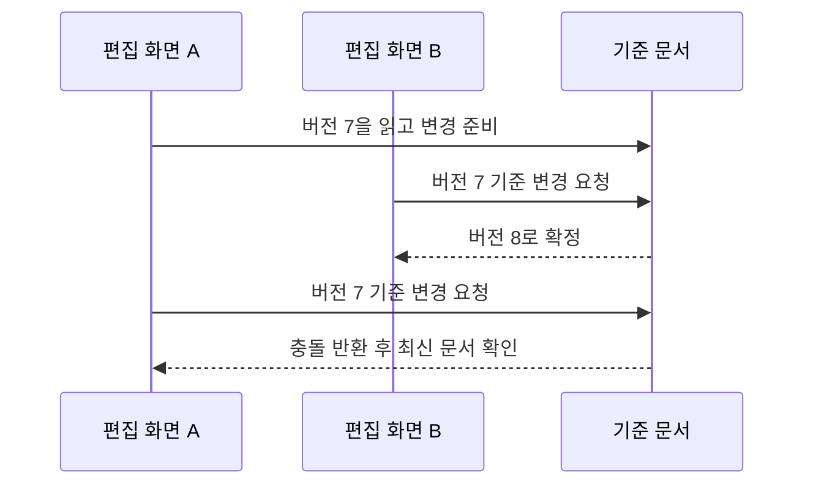

### 1. 개요 및 배경 (Context)

- 편집 내용을 저장하는 동안 다른 화면에서 수정하면, 먼저 읽은 문서로 마지막 쓰기를 하면서 최신 편집 내용이 사라질 수 있는지 검토함.
- 저장 순서를 정렬하는 문제, 읽은 값이 최신인지 검사하는 문제, 디스크에 불완전한 파일을 노출하지 않는 문제를 나눠 봄.

### 2. 핵심 내용 / 문제 해결 과정 (Core / Troubleshooting)

- **마지막 쓰기 우선**은 충돌 처리가 단순함. 먼저 읽었던 문서가 나중에 저장되면 다른 작성자가 반영한 변경까지 덮을 수 있음. **쓰기 직렬화**는 동시에 쓰이는 일을 줄이지만, 대기열에 들어온 값이 오래된 복사본이면 차례가 왔을 때 그대로 기록할 수 있음.
- **낙관적 동시성 검사**는 읽을 때 본 버전을 변경 요청에 함께 전달함. 확정 버전과 일치할 때만 다음 버전을 기록하면 중간 변경을 발견할 수 있음. 그 대신 충돌 뒤에 최신 값을 다시 읽고 사용자 변경을 재적용하거나 충돌 상태를 표시해야 함.
- 한 번의 쓰기에 쓸 데이터는 고정하고 임시 파일 뒤 단일 파일 교체를 고려함. 이 방식은 쓰기 도중 반쯤 저장된 문서 노출을 줄일 수 있음. 여러 파일을 같은 버전으로 보존하는 데에는 추가 커밋 및 복구 규칙이 필요함.

- 도식은 동시 변경을 설명하기 위한 검토 예시임. 당일에는 대기열과 버전, 저장 성공 표시의 책임을 논의했으며 이 설계 전체가 적용됐다는 결과는 확인하지 않음.

### 3. 인사이트 및 적용점 (Takeaway & Next Action)

- **파일 일관성, 실행 순서, 최신성**을 같은 문제로 보면 큐를 추가한 뒤에도 변경 유실을 놓칠 수 있음. 버전 비교는 기준 문서에서 변경을 확정하는 순간과 결합돼야 함.
- 후속 시험은 두 작성자가 같은 버전을 연 뒤 수정하는 경우와 디스크 쓰기 직전에 앱이 종료되는 경우를 나눠 준비할 수 있음.
