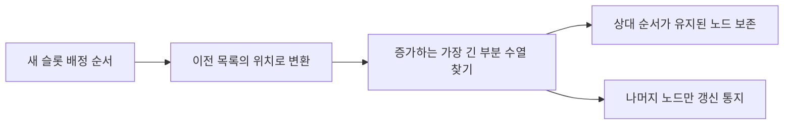

### 1. 개요 및 배경 (Context)

- **질문 요지** Chromium, Safari, Firefox 엔진에서 구조적으로 최적화할 부분이 있는가? 각각의 원인, 해결안, 판단 근거와 측정 방법도 설명해 달라고 요청함.
- Shadow DOM의 슬롯은 외부 자식 노드가 컴포넌트 내부에서 표시될 자리를 정함. Blink에서 슬롯에 배정된 목록의 양 끝 노드만 바꿨는데 가운데 노드까지 대거 스타일 변경 대상으로 잡히는 현상을 확인함.
- 여러 엔진의 비용을 비교했을 때 WebKit은 배정 목록을 만드는 메모리 할당, Gecko는 이름이 맞는 자식을 찾는 탐색이 후보였음. Blink는 불필요한 갱신을 입력으로 재현할 수 있어 먼저 조사함.

### 2. 핵심 내용 / 문제 해결 과정 (Core / Troubleshooting)

- **답변에서 고른 방법** 세 엔진의 후보 가운데 Blink의 큰 슬롯 재배치를 먼저 택하고, 기존 위치를 사용한 최장 증가 부분 수열로 변경 통지를 줄이도록 패치함. 두 노드만 바꾼 입력에서 불필요한 갱신이 늘어나는 현상을 실제 Chrome에서 재현했고, 어떤 목록 비교 분기가 이를 만들었는지도 특정할 수 있었음.
- 변경 전후 목록이 모두 15개 이하면 **최장 공통 부분 수열**을 이용해 유지할 순서를 계산함. 한쪽이 16개 이상이면 앞뒤에서 훑는 그리디 비교를 사용했고, 양 끝 교환에서는 가운데 공통 순서를 놓쳤음.
- 헤드리스 Chrome **157.0.8103.79**의 스타일 무효화 추적에서 양 끝을 교환했을 때 `FlatTreeChange`는 **15행 2건, 16행 15건, 500행 499건**이었음. 이는 다시 처리할 대상으로 표시된 건수이며 화면 전체의 경과 시간과는 다른 지표임.
- 새 목록의 각 노드를 이전 목록의 위치로 바꾼 뒤 **최장 증가 부분 수열**(LIS)을 찾는 방법을 선택함. 예를 들어 위치가 `[5, 2, 3, 4, 1]`로 바뀌면 `[2, 3, 4]`의 상대 순서를 유지할 수 있음. 선형 그리디 방식은 할당이 적고 한 노드 이동에서 이미 잘 작동함. LIS는 교환에서 불필요한 변경을 줄이는 대신 위치 매핑과 순서를 복원할 임시 공간이 필요함.

- **비교 함수만 떼어 낸 C++ 측정** 같은 순서 입력 8개를 표본당 32번씩 반복하고, 처음 5개를 워밍업으로 제외해 구현별 표본 50개를 남김. 두 구현의 실행 순서는 번갈아 바꿈. 아래 시간은 배치의 변경 1회당 평균을 모아 구한 p50임.

| 양 끝 교환 입력 | 갱신 통지 수 |         비교 함수 p50 |
| --------------- | -----------: | --------------------: |
| 100행           |   99건 → 2건 |   4.261 µs → 3.875 µs |
| 500행           |  499건 → 2건 | 56.757 µs → 41.827 µs |

- 이날 패치와 테스트를 작성했고 변경 소스와 테스트의 컴파일 및 Presubmit 통과를 확인함. C++ 측정은 레이아웃 처리 시간을 포함하지 않음. 기준판과 패치판을 실제 브라우저 경로에서 맞춰 잰 결과는 [11월 18일 일지](/til/2026-11-18)에 이어짐.

### 3. 인사이트 및 적용점 (Takeaway & Next Action)

- 같은 수의 DOM 변경 요청이라도 **입력의 순서 패턴**이 내부 작업량을 바꿀 수 있음. 양 끝 교환, 한 행 이동, 무작위 섞기 같은 서로 다른 입력에서 비용을 봐야 적용 범위를 알 수 있음.
