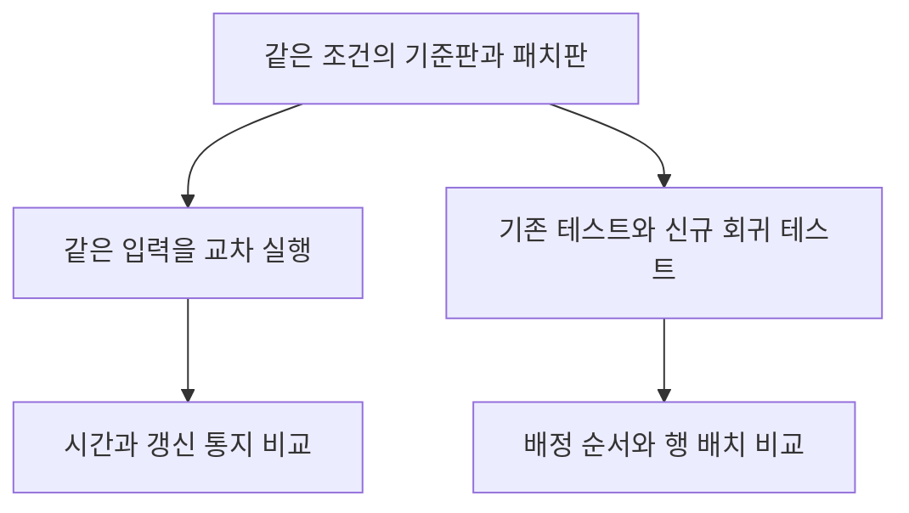

### 1. 개요 및 배경 (Context)

- **질문 요지** 엔진 빌드가 끝나면 실제 브라우저의 변경 전후 성능과 회귀 테스트 결과를 확인해 달라고 요청함.
- [전날 만든 Blink 슬롯 패치](/til/2026-11-17)가 실제 렌더링 경로에서도 효과가 있는지 검증함. 독립 C++ 비교 함수의 속도만으로는 레이아웃 비용과 웹 동작 회귀를 판단하기 어려웠음.
- **같은 변경의 성능과 정확성**을 각각 확인하기 위해 같은 빌드 조건의 기준판 및 패치판과 슬롯 동작 테스트를 사용함.

### 2. 핵심 내용 / 문제 해결 과정 (Core / Troubleshooting)

- **검증에서 고른 방법** 로컬 실행 기록에서는 같은 설정의 기준판과 패치판을 교차 실행하고, 슬롯 변경 후 레이아웃을 읽기까지 측정함. 비교 함수만 얼마나 빨라졌는지로는 브라우저가 다시 배치하는 비용과 실제 표시 결과를 알 수 없어서, 배정 순서와 행 위치도 함께 비교함.
- **측정 조건** Apple M4, RAM 32 GiB, macOS 26.7.2에서 같은 GN 설정의 arm64 Release Content Shell 두 빌드를 비교함. `slot.assign()` 뒤 `offsetHeight`를 읽기까지 걸린 시간을 봄. 표본은 교대 배정 20회의 평균이며, 프로세스마다 40개 중 처음 10개를 워밍업으로 뺐음. 기준판과 패치판을 3쌍 교차 실행해 입력별로 빌드당 **90개 표본, 실제 배정 1,800회**를 기록함. 표의 p50과 p95는 배치 평균의 중앙값과 95번째 백분위수임.
- **혼합 시험** 15, 16, 100, 500행과 6가지 재배치 연산을 같은 시험에 넣음. 양 끝 교환에서 발생한 `FlatTreeChange`는 100행이 **99건 → 2건**, 500행이 **499건 → 2건**이었음.

| 혼합 시험 입력       | p50 기준판 → 패치판 | p95 기준판 → 패치판 |
| -------------------- | ------------------: | ------------------: |
| 100행 양 끝 교환     |    1.775 → 0.225 ms |    2.285 → 0.275 ms |
| 500행 양 끝 교환     |    9.815 → 0.870 ms |   11.955 → 1.055 ms |
| 500행 끝 추가        |    0.820 → 0.965 ms |    1.035 → 1.005 ms |
| 500행 고정 시드 셔플 |   10.380 → 9.570 ms |  24.120 → 55.620 ms |

- **연산별 재측정** 한 번에 한 연산만 새 프로세스에서 실행하고 같은 교대 방식으로 표본을 모음. 셔플에서 혼합 시험의 높은 p95는 그대로 나타나지 않았고, 연산별로 격리한 시험에서는 p50이 소폭 늘었음.

| 격리한 500행 입력 | p50 기준판 → 패치판 | p95 기준판 → 패치판 |
| ----------------- | ------------------: | ------------------: |
| 양 끝 교환        |    9.290 → 0.880 ms |   11.745 → 0.910 ms |
| 끝 추가           |    0.835 → 0.820 ms |    0.845 → 0.835 ms |
| 고정 시드 셔플    |   8.785 → 8.9525 ms |  12.230 → 10.760 ms |

- 동작 검증에서는 **슬롯 배정 순서와 행 배치**가 유지됨을 확인함. 관련 슬롯 단위 테스트 6개와 관련 Web Platform Test 문서 4개가 통과했음. 전체 Blink 단위 테스트에서 보고된 실패 4건과 워커 종료 1건은 기준판에서도 재현됐고, 종료된 테스트는 두 빌드에서 단독 실행 시 통과함.

### 3. 인사이트 및 적용점 (Takeaway & Next Action)

- 빠른 사례 하나만 남기면 적용 판단이 쉬워 보이지만, **공통 순서가 짧은 입력에서 추가 계산이 드는 비용**을 놓치게 됨. 입력별 중앙값과 느린 구간을 함께 남기는 편이 적합함.
- 전체 테스트에 실패가 있으면 기준판과 패치판에서 각각 재현하고, 관련 경로가 유지되는지도 확인해야 새 회귀 여부를 판단할 수 있음.
