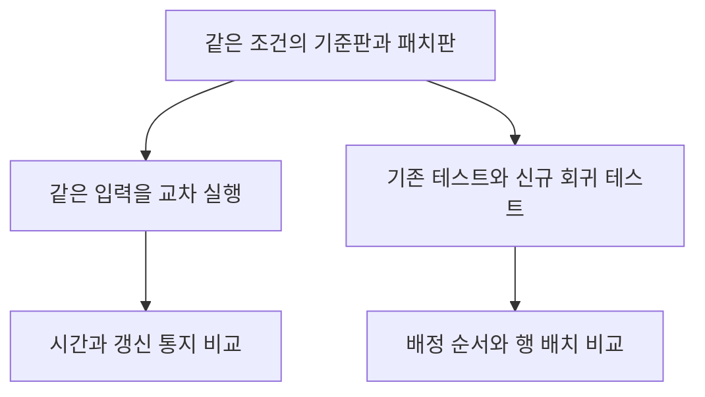

### 1. 개요 및 배경 (Context)

- [전날 만든 Blink 슬롯 패치](/til/2026-11-17)가 실제 렌더링 경로에서도 효과가 있는지 검증함. 독립 C++ 비교 함수의 속도만으로는 레이아웃 비용과 웹 동작 회귀를 판단하기 어려웠음.
- **같은 변경의 성능과 정확성**을 각각 확인하기 위해 같은 빌드 조건의 기준판 및 패치판과 슬롯 동작 테스트를 사용함.

### 2. 핵심 내용 / 문제 해결 과정 (Core / Troubleshooting)

- Apple M4, macOS에서 같은 GN 설정으로 빌드한 arm64 Release Content Shell로 비교함. `slot.assign()` 이후 `offsetHeight`를 읽기까지 측정해 레이아웃 반영을 포함함. 기준판과 패치판을 교차 실행한 프로세스 3쌍에서 입력별로 빌드당 배치 평균 **90개**를 모음.

| 양 끝 교환 입력 | 기준판 p50 | 패치판 p50 | 갱신 통지 변화 |
| --------------- | ---------: | ---------: | -------------: |
| 100행           |   1.775 ms |   0.225 ms |     99건 → 2건 |
| 500행           |   9.815 ms |   0.870 ms |    499건 → 2건 |

- 새 프로세스에서 입력별로 나눈 추가 측정에서는 500행 끝 추가의 p50이 **0.835 → 0.820 ms**, 고정 시드 셔플의 p50이 **8.785 → 8.9525 ms**였음. 양 끝 교환은 보존할 수 있는 공통 순서가 길었음. 여러 입력을 섞은 별도 측정에서는 셔플 p95가 **24.120 → 55.620 ms**로 늘어, 입력과 실행 방식에 따라 느려지는 구간도 있었음.
- 동작 검증에서는 **슬롯 배정 순서와 행 배치**가 유지됨을 확인함. 관련 슬롯 단위 테스트 6개와 관련 Web Platform Test 문서 4개가 통과했음. 전체 Blink 단위 테스트에서 보고된 실패 4건과 워커 종료 1건은 기준판에서도 재현됐고, 종료된 테스트는 두 빌드에서 단독 실행 시 통과함.

### 3. 인사이트 및 적용점 (Takeaway & Next Action)

- 빠른 사례 하나만 남기면 적용 판단이 쉬워 보이지만, **공통 순서가 짧은 입력에서 추가 계산이 드는 비용**을 놓치게 됨. 입력별 중앙값과 느린 구간을 함께 남기는 편이 적합함.
- 전체 테스트에 실패가 있으면 기준판과 패치판에서 각각 재현하고, 관련 경로가 유지되는지도 확인해야 새 회귀 여부를 판단할 수 있음.
