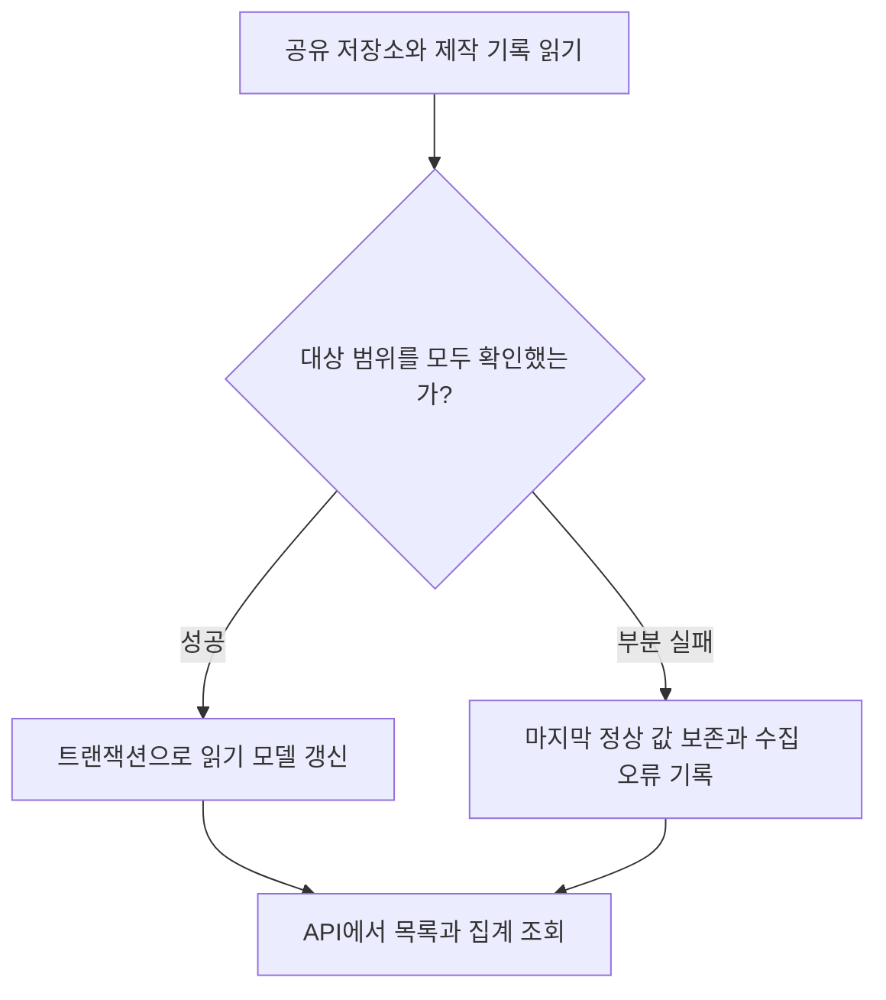

### 1. 개요 및 배경 (Context)

- 기존 제작 상세는 공유 저장소 감시 결과와 제작 기록을 조합해 상태를 보여 줬음. 같은 상태 기준을 전체 목록에 적용해 운영자가 조치나 검수할 항목을 한 화면에서 찾도록 설계함.
- 원본 파일과 제작 기록을 기준으로 유지하면서, 목록 화면에는 **마지막으로 확인한 상태를 담은 읽기 모델**이 필요했음. 읽기 모델은 원본 관찰 결과로 다시 만들 수 있는 조회용 데이터임.

### 2. 핵심 내용 / 문제 해결 과정 (Core / Troubleshooting)

- 원본을 매번 읽으면 별도 복사본이 없어 갱신 처리가 단순함. 대신 요청마다 원본 접근과 집계가 필요하고 저장소가 잠시 읽히지 않을 때는 목록도 영향을 받을 수 있음. 앞서 검토한 SQLite 기반 초안에 이어 **PostgreSQL 읽기 모델**을 선택해 수집과 조회의 시점을 분리함.
- 같은 제작 대상이 재수집돼도 건수가 늘어나지 않도록 **복합 유일 키**로 식별함. 한 항목의 대상 행과 상태 집계를 함께 바꾸는 **트랜잭션**을 사용하면 일부만 새 데이터가 된 화면을 피할 수 있음.
- 일부 원본 범위를 읽지 못하면 마지막 정상 결과를 남기고 오류와 확인 시각을 따로 기록하는 흐름을 적용함. 목록은 계속 조회할 수 있는 대신, 화면에 표시한 숫자가 언제 관찰된 값인지 드러내야 함.

- 당일 PostgreSQL을 개발 및 운영 환경에 구성하고 서버와 웹을 배포함. 운영에서 API와 DB의 항목 및 제작 대상 건수가 일치했고, 화면에서 조치 필요와 검수 대기 표시를 확인함. 개발에서는 공유 저장소 읽기가 일시 중지된 상태여서 빈 목록으로 확인됨.

### 3. 인사이트 및 적용점 (Takeaway & Next Action)

- 읽기 모델의 일관성은 **한 번에 바뀌어야 할 행의 범위**로 정해지고, 최신성은 **마지막 관찰 시점**으로 설명해야 함. 둘을 분리하면 결과 없음과 수집 실패를 화면에서 혼동하지 않게 됨.
- 후속 검증은 같은 관찰값의 재처리, 일부 원본만 실패한 갱신, 수집이 늦어질 때의 표시를 각각 확인할 수 있음.
