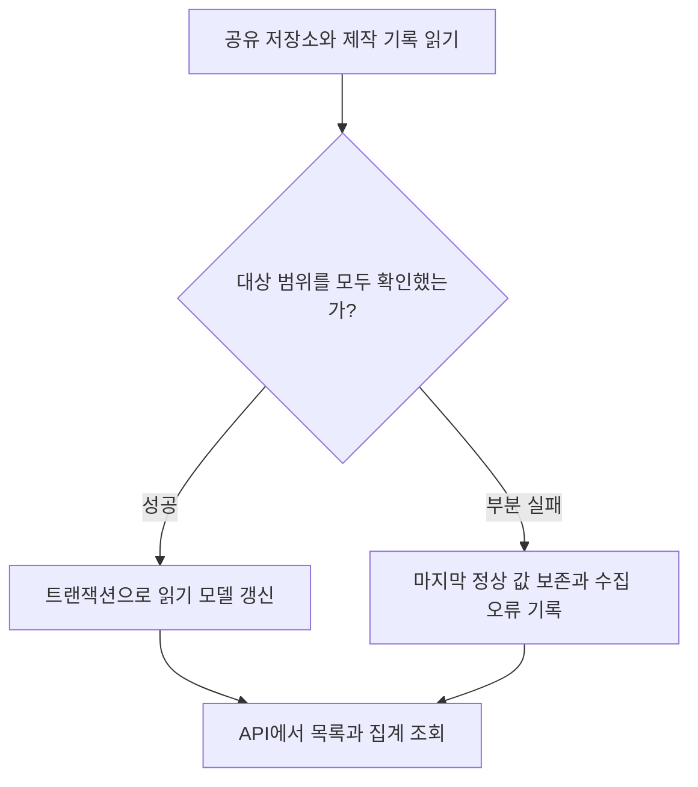

### 1. 개요 및 배경 (Context)

- **질문 요지** 전체 대시보드를 만들 때 SQLite와 PostgreSQL 중 어느 쪽이 적합한가? SQLite로 먼저 만들기로 했다가, 여러 사람이 웹을 쓰면 PostgreSQL이 필요한지와 개발 및 운영 연결을 어떻게 나눌지 이어서 물음.
- 기존 제작 상세는 공유 저장소 감시 결과와 제작 기록을 조합해 상태를 보여 줬음. 같은 상태 기준을 전체 목록에 적용해 운영자가 조치나 검수할 항목을 한 화면에서 찾도록 설계함.
- 원본 파일과 제작 기록을 기준으로 유지하면서, 목록 화면에는 **마지막으로 확인한 상태를 담은 읽기 모델**이 필요했음. 읽기 모델은 원본 관찰 결과로 다시 만들 수 있는 조회용 데이터임.

### 2. 핵심 내용 / 문제 해결 과정 (Core / Troubleshooting)

- **답변에서 고른 방법** 먼저 SQLite로 감시 결과를 저장하고 목록 API에서 집계하는 흐름을 검증함. 여러 사람이 화면을 여는 것은 주로 조회를 늘리고, 실제 쓰기는 수집기가 하므로 접속 인원만으로 DB를 바꿀 이유는 부족했음. 이후 PostgreSQL 전환 결정에 따라 같은 읽기 모델을 유지하면서 DB를 별도 서비스로 두고 개발과 운영의 연결 및 저장 공간을 나눔. 향후 수집기와 여러 서버가 같은 DB를 사용하기 쉬운 대신 운영 대상이 늘어나는 선택이었음.
- 원본을 매번 읽으면 별도 복사본이 없어 갱신 처리가 단순함. 대신 요청마다 원본 접근과 집계가 필요하고 저장소가 잠시 읽히지 않을 때는 목록도 영향을 받을 수 있음. 앞서 검토한 SQLite 기반 초안에 이어 **PostgreSQL 읽기 모델**을 선택해 수집과 조회의 시점을 분리함.
- 같은 제작 대상이 재수집돼도 건수가 늘어나지 않도록 **복합 유일 키**로 식별함. 한 항목의 대상 행과 상태 집계를 함께 바꾸는 **트랜잭션**을 사용하면 일부만 새 데이터가 된 화면을 피할 수 있음.
- 일부 원본 범위를 읽지 못하면 마지막 정상 결과를 남기고 오류와 확인 시각을 따로 기록하는 흐름을 적용함. 목록은 계속 조회할 수 있는 대신, 화면에 표시한 숫자가 언제 관찰된 값인지 드러내야 함.

- **SQLite 초안의 로컬 검증** 같은 관찰 결과로 상세와 대시보드의 제작 대상 집계가 일치했으며, 대시보드 조회 요청에 수반된 NAS 마운트 조회는 **0회**였음. 공유 저장소 읽기를 중지한 뒤에도 마지막 상태를 볼 수 있었음. 이는 조회 경로를 확인한 결과이며 응답 시간 개선율은 측정하지 않았음.
- **PostgreSQL 전환 검증** 로컬 PostgreSQL에서 NAS 시험 데이터 **8건**이 대시보드 응답에 반영됐으며, 갱신 중 오류를 넣으면 직전 결과가 보존됐음. 개발 및 운영 배포 후 운영에서 API와 DB의 항목 수 및 제작 대상 수를 대조했고 두 집계의 차이는 각각 **0건**이었음. 개발에서는 공유 저장소 읽기가 일시 중지된 상태여서 빈 목록이 반환됐음.

### 3. 인사이트 및 적용점 (Takeaway & Next Action)

- 읽기 모델의 일관성은 **한 번에 바뀌어야 할 행의 범위**로 정해지고, 최신성은 **마지막 관찰 시점**으로 설명해야 함. 둘을 분리하면 결과 없음과 수집 실패를 화면에서 혼동하지 않게 됨.
- 후속 검증은 같은 관찰값의 재처리, 일부 원본만 실패한 갱신, 수집이 늦어질 때의 표시를 각각 확인할 수 있음.
