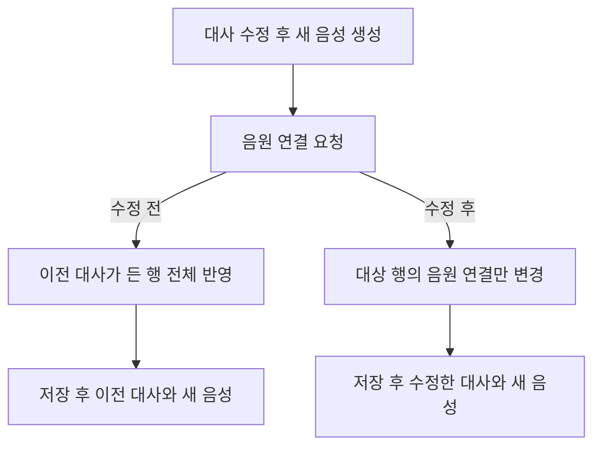

### 1. 개요 및 배경 (Context)

- 스크립트를 수정해 새 음성을 만든 뒤 저장까지 완료했는데, 파일을 다시 열자 **새 음성은 남고 대사만 이전 값으로 돌아가는** 제보를 받음.
- 처음에는 별도 창 편집이 저장 전에 반영되지 않는 조건을 재현함. 제보자는 한 창을 나눠 편집하고 단축키 저장이 끝날 때까지 기다렸다고 설명했으므로, 분리 창의 대기 변경 처리만으로 설명할 수 없는 경로를 다시 살펴봄.

### 2. 핵심 내용 / 문제 해결 과정 (Core / Troubleshooting)

- 메인 창에서 화면의 스크립트 갱신이 늦을 때를 모의로 만들었음. 음성 생성에는 최신 대사가 들어갔지만, **음원을 연결하는 코드가 화면에 남아 있던 이전 행 전체를 읽어 연결 정보와 대사를 함께 반환**했음. 이때 저장 전에 기준 문서가 이미 새 음원과 이전 대사로 어긋났음.
- 저장 직전 반영을 기다리는 방법은 대기 중인 편집을 처리할 수 있지만, 이미 이전 대사로 덮인 상태는 복구하기 어려움. 행 전체를 새로 읽어 다시 보내는 방식도 수정을 보내는 사이 값이 달라질 수 있음. 음원 연결 작업에서 **대상 행의 식별자와 바꿀 연결 필드만** 넘겨 최신 대사에 쓰기 권한이 미치지 않도록 수정함.
- 트랜잭션 아웃박스도 검토함. 문서 변경과 나중에 전달할 알림을 함께 저장해 발행 누락을 줄일 수 있지만, 음원 연결 요청에 포함된 이전 대사를 수정하는 책임은 쓰기 명령의 계약에 있음.

- 화면 조회가 늦는 조건을 만든 실제 Electron 시험에서 AS-IS와 TO-BE를 같은 저장 및 재열기 과정으로 확인함. 수정 후 **변경한 대사와 새 음원이 함께 열렸고**, 저장된 WAV 해시가 테스트 원본과 일치함. 실행 취소와 다시 실행에서도 연결만 바뀌는지 확인함. 제보 당시의 타이밍 자체가 같았는지는 확인되지 않았음.

### 3. 인사이트 및 적용점 (Takeaway & Next Action)

- 저장 후 값이 돌아가는 현상은 **쓰기 시점, 저장 직전 기준 문서, 재열기 결과**를 따로 봐야 함. 이 재현에서는 디스크 저장을 정상적으로 마쳐도 이미 어긋난 값이 그대로 기록됐음.
- 부분 변경을 시험할 때는 요청한 필드의 결과와 함께 **요청하지 않은 필드가 그대로인지**를 확인해야 의도보다 넓게 쓰는 회귀를 잡을 수 있음.
