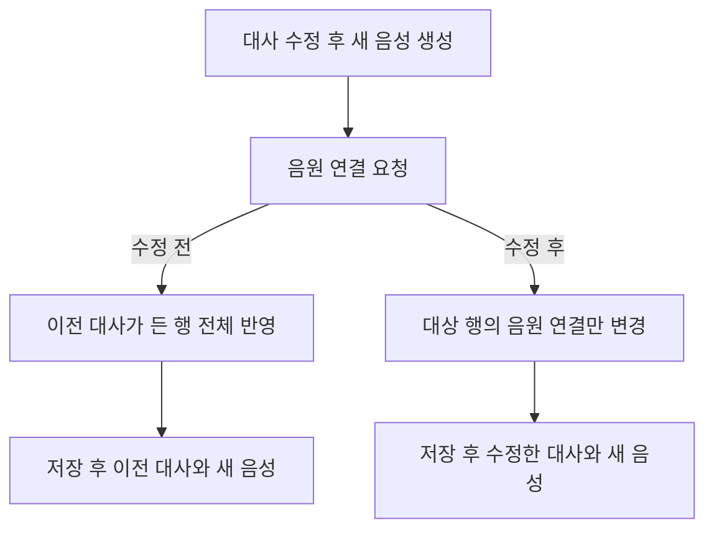

### 1. 개요 및 배경 (Context)

- **질문 요지** 저장 후 새 음성은 남는데 대사만 예전으로 돌아가는 이유는 무엇인가? 제보자가 한 창에서 저장 완료를 기다렸다는 조건을 다시 전달하고, 수정이 트랜잭션 아웃박스인지와 왜 그 방식이 적합한지도 물음.
- 스크립트를 수정해 새 음성을 만든 뒤 저장까지 완료했는데, 파일을 다시 열자 **새 음성은 남고 대사만 이전 값으로 돌아가는** 제보를 받음.
- 처음에는 별도 창 편집이 저장 전에 반영되지 않는 조건을 재현함. 제보자는 한 창을 나눠 편집하고 단축키 저장이 끝날 때까지 기다렸다고 설명했으므로, 분리 창의 대기 변경 처리만으로 설명할 수 없는 경로를 다시 살펴봄.

### 2. 핵심 내용 / 문제 해결 과정 (Core / Troubleshooting)

- **답변에서 고른 방법** 분리 창의 편집 대기 문제에서 한 창의 음원 연결 경로로 조사 대상을 바꿈. 저장 자체는 정상이어도 연결 명령이 이전 대사까지 덮으면 잘못된 상태가 그대로 기록됨. 그래서 메시지 재전달을 보장하는 아웃박스 대신, 음원 연결 명령이 대상과 연결 정보만 쓰도록 수정함.
- 메인 창에서 화면의 스크립트 갱신이 늦을 때를 모의로 만들었음. 음성 생성에는 최신 대사가 들어갔지만, **음원을 연결하는 코드가 화면에 남아 있던 이전 행 전체를 읽어 연결 정보와 대사를 함께 반환**했음. 이때 저장 전에 기준 문서가 이미 새 음원과 이전 대사로 어긋났음.
- 저장 직전 반영을 기다리는 방법은 대기 중인 편집을 처리할 수 있지만, 이미 이전 대사로 덮인 상태는 복구하기 어려움. 행 전체를 새로 읽어 다시 보내는 방식도 수정을 보내는 사이 값이 달라질 수 있음. 음원 연결 작업에서 **대상 행의 식별자와 바꿀 연결 필드만** 넘겨 최신 대사에 쓰기 권한이 미치지 않도록 수정함.
- 트랜잭션 아웃박스도 검토함. 문서 변경과 나중에 전달할 알림을 함께 저장해 발행 누락을 줄일 수 있지만, 음원 연결 요청에 포함된 이전 대사를 수정하는 책임은 쓰기 명령의 계약에 있음.

- **회귀 시험 조건** macOS Electron 앱에서 화면이 이전 행을 읽도록 지연 조건을 만들고, 음성 생성 응답은 같은 테스트 WAV로 대체함. 변경 전후에 실제 파일을 저장하고 프로젝트를 다시 열어 대사와 음원 연결을 비교함.

| 확인 대상                         | 수정 전                   | 수정 후                                               |
| --------------------------------- | ------------------------- | ----------------------------------------------------- |
| 재열기 직후 대사                  | 수정 이전 문장            | 새로 편집한 문장                                      |
| 재열기 직후 음원                  | 새 음원 연결              | 새 음원 연결이 유지되고 파일 해시가 테스트 WAV와 일치 |
| 음원 연결의 실행 취소와 다시 실행 | 당일 비교 기록에서 미확인 | 연결 상태만 바뀌고 편집한 대사가 유지됨               |

- 이 시험은 덮어쓰기를 일으키는 조건을 재현해 동작을 비교한 결과임. 실제 제보에서 동일한 타이밍이 발생했는지와 발생 빈도는 확인되지 않았음.

### 3. 인사이트 및 적용점 (Takeaway & Next Action)

- 저장 후 값이 돌아가는 현상은 **쓰기 시점, 저장 직전 기준 문서, 재열기 결과**를 따로 봐야 함. 이 재현에서는 디스크 저장을 정상적으로 마쳐도 이미 어긋난 값이 그대로 기록됐음.
- 부분 변경을 시험할 때는 요청한 필드의 결과와 함께 **요청하지 않은 필드가 그대로인지**를 확인해야 의도보다 넓게 쓰는 회귀를 잡을 수 있음.
