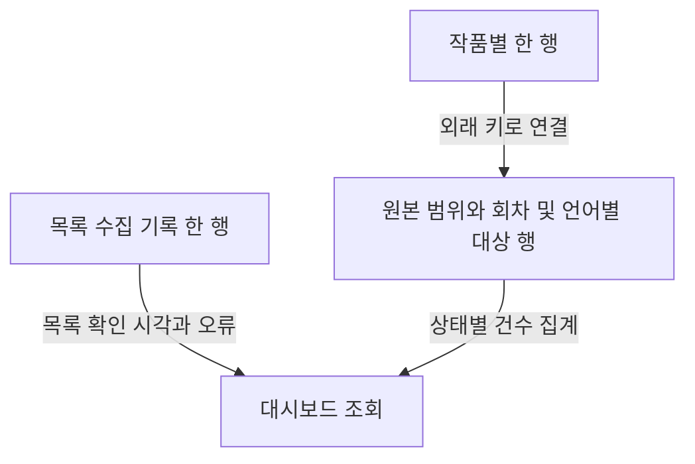

### 1. 개요 및 배경 (Context)

- [읽기 모델을 도입한 뒤](/til/2026-11-20) PostgreSQL 스키마를 읽으며 대시보드에서 말하는 전체, 완료, 검수 대기의 1건이 각각 무엇인지 확인함.
- 같은 시즌과 회차라도 원본 범위나 대상 언어가 다르면 별개의 제작 대상임. 회차 번호만으로 합치거나 실행 이력을 세면 화면에서 보여 줄 건수가 달라짐.

### 2. 핵심 내용 / 문제 해결 과정 (Core / Troubleshooting)

- 테이블의 역할을 **목록 수집 기록, 작품, 제작 대상**으로 나눠 읽음. 목록 수집 기록은 전체 확인 시각과 오류를 보관하며, 작품 행은 해당 작품의 등록 정보와 마지막 확인 상태를 보관함.
- 제작 대상 한 행은 **작품, 원본 폴더, 시즌, 회차, 대상 언어의 조합**을 나타냄. 작품의 식별자를 외래 키로 참조하는 1:N 관계임. 작품당 한 행에 집계만 저장하면 목록 조회는 단순하지만, 어떤 회차와 언어가 각 건수에 들어갔는지 확인하기 어려움. 대상 행을 유지하면 집계 근거를 남기는 대신 유일 키와 갱신 범위를 관리해야 함.
- 실제 코드에서 한 작품의 원본 범위가 모두 확인되면 대상 행을 트랜잭션으로 교체하고, 일부를 읽지 못하면 마지막 정상 값을 보존함. 조회는 대상 행으로 작품별 건수를 구함.

- 예를 들어 한 회차의 영어판은 제작이 완료됐고 아직 검수를 기다릴 수 있음. 코드에서 이 대상은 **완료 1건과 검수 대기 1건에 동시에** 포함될 수 있음을 확인함. 집계 결과의 합이 전체 대상 수와 늘 같아야 한다고 가정하면 이 동작을 오류로 판단하게 됨.

### 3. 인사이트 및 적용점 (Takeaway & Next Action)

- 집계 SQL을 쓰기 전에 **기본 단위와 중복 허용 여부**를 먼저 적으면 조인에서 행이 늘어나는 문제와 의도적으로 겹치는 조건을 구분할 수 있음.
- 새 지표를 검증할 때는 한 회차 다국어, 대상 하나의 여러 실행, 제작 완료 및 검수 대기 동시 충족을 각각 넣어 기대 건수를 확인할 수 있음.
