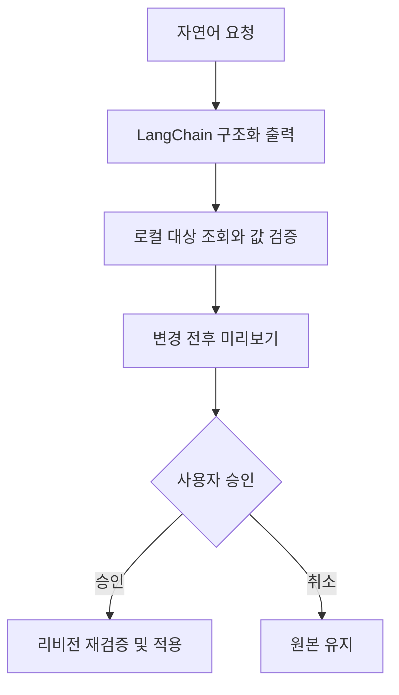

### 1. 개요 및 배경 (Context)

- **질문 요지** 어엿비에 LangGraph, LangChain, RAG 중 무엇을 적용하면 좋은가? 각각의 선택 근거와 트레이드오프는 무엇인가? 세 기술이 같은 역할이라면 하나만 사용해도 되지 않는가?
- 기존 데스크톱 DAW에는 프로젝트 상태 조회, 편집 미리보기, 사용자 승인 후 적용, Undo를 수행하는 로컬 제어 API와 CLI가 있었음.
- 자연어로 “선택한 보컬을 3dB 내려줘”라고 요청할 때 모델의 해석과 실제 곡의 편집이 어긋나지 않아야 함.

### 2. 핵심 내용 / 문제 해결 과정 (Core / Troubleshooting)

- **답변에서 고른 방법** 처음에는 승인과 재개를 표현하기 위해 LangGraph까지 도입하는 안을 검토함. 사용자가 세 기술을 모두 써야 하는지 다시 질문하자 첫 버전의 편집에는 LangChain의 모델 어댑터와 구조화 출력만 사용하고, 실행 흐름은 기존 앱과 TypeScript로 연결하기로 결정함.
- LangChain은 문장을 대상, 연산, 값으로 구조화하는 역할임. 직접 모델 API를 호출하면 의존성이 적지만, 어댑터를 사용하면 편집 계약과 로컬 검증을 모델 호출 코드에서 분리하기 쉬움. 공급자 변경 시에는 다시 검증해야 하며, 구조화 출력은 의미의 정확성까지 보장하지 않음.
- LangGraph는 추가 질문, 리듬 후보 생성, 미리듣기와 선택 등 여러 번 멈췄다 이어가는 실행 상태를 관리하는 데 검토할 수 있음. 체크포인트와 재개 기능을 얻는 대신 상태 저장소, 후보 수명과 중복 적용 규칙을 관리해야 함. 승인 한 번으로 끝나는 첫 편집에는 미도입함.
- RAG는 설치 버전의 매뉴얼에서 근거를 찾아 사용법을 답할 때 적합함. 현재 트랙의 게인처럼 실시간으로 바뀌는 값은 검색 인덱스가 아니라 앱의 상태 조회 API에서 읽는 것이 적절함. 첫 버전에는 별도 문서 검색을 도입하지 않음.
- **상대값과 절대값 구분** 현재 게인이 -6dB인 경우 “3dB 내려줘”는 -9dB, “-3dB로 맞춰줘”는 -3dB임. 모델은 연산의 의미만 반환하고, 실제 대상 조회와 최종값 계산은 로컬 코드에 맡김.

- 승인 대기 중 곡이나 리비전이 바뀌면 이전 미리보기를 거절함. 적용 응답이 유실됐을 때는 새 요청을 실행하지 않고 같은 요청 ID의 결과를 먼저 조회함. 요청 원장은 메모리 기반이므로 프로세스 재시작까지 중복 방지를 보장하지 않음.
- **검증 조건** macOS 개발 빌드와 데모 곡을 사용하고 모델 응답은 고정함. 한국어 요청 매핑 사례 30개, 앱 통합 및 네이티브 회귀 테스트로 편집 경로를 검증함.

| 검증 항목 | 결과 |
| --- | --- |
| 한국어 요청과 고정 응답 매핑 | 30개 통과 |
| AI 편집 보조 테스트 | 34/34 통과 |
| macOS 네이티브 CTest | 46/46 통과 |
| 보컬 게인 미리보기와 승인 후 적용 | 0dB에서 -3dB로 변경 |
| Undo | 0dB 복원 |
| 적용 응답 유실 | 기존 결과 조회로 중복 적용 방지 |

- CLI, 승인 및 Undo, DAW 패널을 기능별 PR로 구현해 병합하고 [macOS 0.1.2 베타](https://github.com/whizzkid1452/ayotbi-downloads/releases/tag/v0.1.2)로 배포함. 실제 OpenAI 호출의 한국어 해석 정확도, 지연 및 비용은 API 키가 없는 환경에서 미검증임. LangGraph와 RAG는 후속 검토 범위임.

### 3. 인사이트 및 적용점 (Takeaway & Next Action)

- AI 제품의 기술 선택은 도구 이름이 아니라 **해결하려는 문제와 상태의 소유권**에서 출발해야 함. 현재 값은 앱에서 조회하고, 모델은 의도를 해석하며, 최종 편집 확정은 기존 엔진에 맡기는 것이 이번 결정의 기준임.
- 구조화 출력의 형식 검증과 실제 의미 해석 품질을 구분하고, 후속 실모델 평가에서 상대값과 절대값 및 모호한 요청의 정확도, 지연 시간과 비용을 별도로 측정할 필요가 있음.
