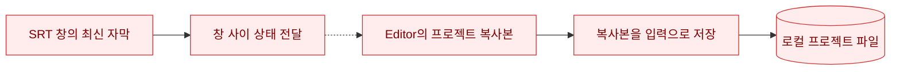
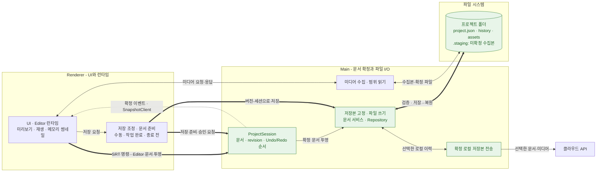

# Electron 프로젝트 SSOT와 저장·복구 구조 개편

여러 창이 공유하는 프로젝트 문서의 확정 권한을 Main Process에 두고, 수동·자동 저장과 종료 전 저장을 공통 흐름으로 연결했습니다. 저장할 문서와 미디어 참조를 같은 버전으로 확정한 뒤 로컬 이력에 기록하고, 클라우드 전송은 선택한 로컬 저장본을 기준으로 수행하도록 구성했습니다.

> 코드 확인 기준: 2026-10-28, Dyna Studio `10e09bb6`. 현재 체크아웃의 구현 경로를 설명하며, 실제 앱의 저장·복구 성공률이나 성능 개선 수치를 측정한 결과는 아닙니다.

관련 글: [상태의 확정 권한을 Main Process에 둔 이유](../content/posts/electron-main-process-ssot-decision.md), [Main SSOT를 저장까지 확장한 과정](../content/posts/electron-main-process-ssot-save-recovery.md)

## AS-IS

기존 구조에서는 Editor, Admin, SRT Script Panel이 공유 프로젝트 데이터를 각 Renderer의 Store에 보관했습니다. 최신 자막이 한 창에만 반영되면, 다른 창의 오래된 복사본이 자동 저장의 입력이 될 수 있었습니다.

파일 쓰기가 성공해도 저장한 내용이 사용자의 최신 편집과 다를 수 있다는 것이 문제였습니다. 상태의 확정 권한을 정하는 일과 함께, 문서 준비·미디어 수집·파일 교체·복구·서버 전송이 어느 버전을 기준으로 실행되는지도 명확히 해야 했습니다.

## TO-BE

실행 중 프로젝트 문서, 화면의 실행 객체, 디스크에 확정한 저장본을 구분했습니다. Main은 프로젝트 문서의 변경을 승인하고, Renderer는 입력·미리보기·재생과 저장 준비를 담당합니다.

| 영역               | 책임                                                                                              |
| ------------------ | ------------------------------------------------------------------------------------------------- |
| Renderer           | SRT 변경 요청, Editor 문서 투영, 임시 미리보기, 재생·디코딩, 메모리 썸네일, 저장 준비와 청크 전송 |
| Main 프로젝트 상태 | 명령 검증, 문서와 revision 확정, 이벤트 발행, Undo/Redo 순서 관리                                 |
| Main 저장 계층     | 저장 대상 고정, 프로젝트별 순차 쓰기, 미디어 검증, 저장 이력과 현재 문서 교체                     |
| 파일 시스템        | 미확정 미디어 수집본, 현재 저장본, 확정 이력과 미디어 파일                                        |
| 클라우드 전송      | 확정 로컬 이력 ID로 문서·미디어를 읽어 전송하고 결과를 별도 기록                                  |

다음 구조도는 변경 요청과 저장 요청을 구분한 현재 실행 경로입니다. 굵은 화살표는 문서 확정과 로컬 저장의 중심 흐름을 나타냅니다. 넓은 구조도는 좌우로 스크롤해 볼 수 있습니다.

프로젝트 문서는 Main에서 확정하고, 저장은 고정한 버전을 기록하며, 전송은 확정 로컬 저장본을 읽습니다. 열기·복원에서는 별도의 문서 적용 경로가 화면과 실행 객체를 복원합니다.

구조도의 저장 조정·문서 준비는 Renderer의 ProjectSaveCoordinator와 editorProjectPersistence입니다. Main의 저장본 고정·파일 쓰기는 ProjectDocumentService, ProjectRepository, JsonProjectStore를 묶어 표현했습니다. 미디어 수집·범위 읽기는 projectMediaStaging과 projectMediaProtocol의 책임입니다. 각 책임을 하나의 새 클래스로 합쳤다는 뜻은 아닙니다.

## 핵심 변경

### 1. 프로젝트 문서의 확정 권한과 Renderer의 책임 분리

**As-Is:** 각 창이 공유 문서의 복사본을 보유해 어떤 값이 최종 상태인지 판단하기 어려웠습니다.

**문제 상황:** 한 창의 변경을 전달하지 못하면 다른 창에서 오래된 내용을 저장할 수 있었습니다.

**To-Be:** SRT 변경은 세션·기준 revision·명령 ID를 담아 Main에 전달합니다. ProjectSession이 검증한 변경을 확정하고, ProjectSnapshotClient는 확정 이벤트를 순서대로 반영합니다. 이벤트 사이 revision이 비면 스냅샷을 다시 조회합니다.

Editor는 로컬 Store와 실행 객체를 유지하며 저장 가능한 문서를 Main에 투영합니다. 모든 UI·편집 명령을 Main으로 이전했다고 표현하지 않습니다. Main의 Undo/Redo는 자체 문서 patch와 Renderer에 실행을 위임하는 Editor 항목의 순서를 함께 관리합니다.

**해결되는 문제:** 공유 문서의 최종 변경 권한과 화면의 로컬 상태를 구분하고, 오래된 이벤트나 다른 프로젝트의 응답을 받아들이는 조건을 명시했습니다.

### 2. 문서 준비와 실제 저장 사이에 버전 계약 도입

**As-Is:** 화면의 여러 값을 저장 때 다시 조립하면 문서와 미디어 참조의 시점이 달라질 수 있었습니다.

**문제 상황:** 비동기 준비 중 다른 편집이나 프로젝트 전환이 발생했을 때, 앞서 읽은 값을 그대로 저장해도 되는지 판단해야 했습니다.

**To-Be:** 수동·자동·종료 전 저장을 ProjectSaveCoordinator로 모았습니다. 대기 중 변경을 동기화하고 저장용 문서와 미디어 목록을 준비한 뒤, `prepare-project-save` 명령으로 같은 버전에 반영합니다. 저장 시작 요청은 문서 본문 대신 확정 revision·프로젝트 세션·경로를 보냅니다.

Main은 이를 검사하고 저장할 문서를 복사해 고정합니다. 고정 뒤의 편집은 다음 미저장 변경으로 남깁니다. 같은 프로젝트의 파일 쓰기는 프로젝트별 대기열에서 순차 실행합니다.

**해결되는 문제:** 저장할 문서·미디어의 기준을 명시하고, 이전 저장 완료가 그 뒤의 편집까지 저장된 것으로 표시하는 상황을 구분합니다.

자동 저장은 작업 완료 신호를 사용합니다. 고정 3초 debounce 방식이 아니며, Editor 문서를 Main 메모리에 투영하는 50ms 대기는 디스크 저장 간격과 구분합니다. 작업 중인 자동 저장 요청은 보류하고, 저장 실패 뒤에는 편집 내용과 오류를 유지한 채 수동 저장을 안내합니다.

### 3. 프로젝트 파일과 재생·화면 캐시의 역할 분리

**As-Is:** 이전 버전의 미디어 복사본과 초안·썸네일을 IndexedDB에 보관하면서 프로젝트 파일과 별도 저장 영역을 함께 다뤘습니다.

**문제 상황:** 프로젝트를 다시 여는 데 필요한 원본과 재생성 가능한 캐시의 보존·정리 기준을 구분해야 했습니다.

**To-Be:** 프로젝트는 `project.json`, `history/`, `assets/`를 가진 앱 관리 폴더에 저장합니다. 가져오거나 생성한 미디어는 먼저 프로젝트 내부 `.staging/`에 수집하고, 저장 과정에서 크기·내용 해시를 확인해 `assets/`에 반영합니다.

Renderer는 세션이 포함된 `dyna-media:` URL로 미디어를 읽습니다. Main이 현재 세션을 확인하고 필요한 바이트 범위를 응답합니다. 썸네일은 메모리에서 관리하며, 이전 AudioEditorDB와 ThumbnailCacheDB는 시작 시 정리 대상입니다. 별도의 VoiceCatalogDB는 유지합니다.

**해결되는 문제:** 보존할 미디어와 재생성 가능한 썸네일의 책임을 나누고, 미디어 원본을 프로젝트 폴더 기준으로 추적할 수 있게 했습니다. 수집 파일의 존재만으로 저장 완료나 복구 가능한 이력으로 간주하지 않습니다.

### 4. 로컬 저장 이력과 클라우드 전송 기준 연결

**As-Is:** 실행 중 문서를 전송 때 다시 읽으면 로컬 저장본과 서버 전송본이 서로 다른 편집 시점일 수 있었습니다.

**문제 상황:** 전송 중 새 편집이 생기거나 과거 이력을 복원할 때 현재 문서와 선택한 저장본을 구분해야 했습니다.

**To-Be:** JSON 저장소가 새 이력과 임시 head 파일을 기록·동기화한 뒤 현재 문서를 한 번의 이름 변경으로 교체합니다. 이력은 현재 head의 이전 저장 ID를 따라 조회합니다. 과거 버전 복원은 기존 이력을 덮지 않고 새 revision을 만듭니다.

클라우드 전송은 선택한 로컬 이력 ID를 고정해 해당 문서와 미디어를 읽습니다. 전송 중 현재 head가 바뀌어도 대상을 바꾸지 않으며, 결과는 문서 JSON과 별도로 기록합니다. IndexedDB의 영속 Outbox를 구현했다는 뜻은 아닙니다.

**해결되는 문제:** 로컬 저장 성공과 서버 전송 성공을 분리하고, 어떤 저장본을 복원하거나 전송했는지 이력 ID로 연결할 수 있게 했습니다.

## 결과와 검증 범위

현재 코드에서 확인할 수 있는 변화는 다음과 같습니다.

- 저장 시작 API가 Renderer의 문서를 다시 받지 않고 Main이 승인한 버전과 프로젝트 식별자를 사용합니다.
- 수동·자동·종료 전 저장이 공통 경로를 사용하며, 저장 중 추가된 변경과 저장 완료 버전을 구분합니다.
- 로컬 복원은 새 이력을 남기고, 클라우드 전송은 선택한 확정 로컬 저장본을 읽습니다.
- 미디어 원본과 메모리 썸네일을 분리하고, 구형 미디어·썸네일 IndexedDB를 현재 저장 원본으로 사용하지 않습니다.

문서 작성 과정에서 실제 Electron의 다중 창 편집, 대용량 저장, 강제 종료 복구, 네트워크 차단 후 전송을 실행 검증하지 않았습니다. 오류율·저장 시간·복구 성공률도 측정하지 않았으므로 데이터 유실의 완전한 제거, 전원 차단 내구성, 기기 간 자동 병합을 성과로 주장하지 않습니다.

실행 중 Undo/Redo와 디스크의 저장 이력은 다른 수명으로 관리합니다. 저장 이력의 보관 한도와 잔여 파일 정리는 별도 정책으로 남습니다.

## 포트폴리오용 요약

- **Electron 프로젝트 SSOT와 저장·복구 구조 개편**
  - 문제: 여러 창의 프로젝트 복사본과 저장 경로가 서로 다른 시점의 문서를 참조할 수 있었습니다.
  - 구현: Main의 문서 확정 권한을 기준으로 수동·자동·종료 전 저장을 통합하고, 문서·미디어 목록을 같은 버전으로 준비한 뒤 세션과 revision을 검사해 저장하도록 구성했습니다.
  - 확장: 프로젝트 파일·저장 이력·미디어와 화면 캐시의 책임을 분리하고, 복원은 새 revision으로 기록하며 클라우드는 선택한 확정 로컬 저장본을 전송하도록 연결했습니다.
  - 확인된 변화: 저장·복원·전송의 기준 문서를 추적할 수 있습니다. 운영 오류율이나 성능 개선 수치는 별도 측정하지 않았습니다.

## 회고

SSOT를 도입한 뒤에도 저장할 문서를 언제 고정할지, 미디어를 언제 확정할지, 이전 저장 완료를 어느 편집 버전까지 반영할지 결정해야 했습니다. 이후에는 상태의 소유 위치와 함께 비동기 작업이 참조하는 버전, 성공으로 표시하는 시점, 실패 뒤 보존할 데이터를 같은 범위에서 검토하게 됐습니다.

## 구현 근거

비공개 저장소 Dyna Studio의 다음 경로를 기준으로 확인했습니다.

| 근거 경로                                                                                                                    | 확인 내용                                         |
| ---------------------------------------------------------------------------------------------------------------------------- | ------------------------------------------------- |
| `src/main/projectSession.ts`, `projectSessionRuntime.ts`                                                                     | 명령 검증, 문서 확정, 저장 계층 투영, Undo/Redo   |
| `src/renderer/src/project/ProjectSnapshotClient.ts`                                                                          | 확정 이벤트와 revision gap 처리                   |
| `src/renderer/src/studio/editor/save/ProjectSaveCoordinator.ts`, `autoSave.ts`                                               | 공통 저장 경로, 작업 완료, 대기·실패 처리         |
| `src/renderer/src/studio/editor/save/editorDocumentProjector.ts`, `editorProjectPersistence.ts`                              | 문서 투영, 저장 준비, 버전 기반 begin과 청크 전송 |
| `src/main/projectDocumentService.ts`, `editor-snapshot-save.ts`                                                              | 저장본 고정, 프로젝트 검사, 다음 편집 유지        |
| `src/main/projectRepository.ts`, `jsonProjectStore.ts`, `projectWriteQueue.ts`                                               | 순차 쓰기, 검증, 이력과 head 교체                 |
| `src/main/projectMediaStaging.ts`, `projectMediaProtocol.ts`                                                                 | 미디어 수집과 세션별 범위 읽기                    |
| `src/renderer/src/shared/storage/legacyIndexedDbCleanup.ts`, `src/renderer/src/studio/editor/engine/video/thumbnailCache.ts` | 구형 DB 정리와 메모리 썸네일                      |
| `src/main/projectCloudService.ts`                                                                                            | 확정 로컬 이력 기반 전송                          |
